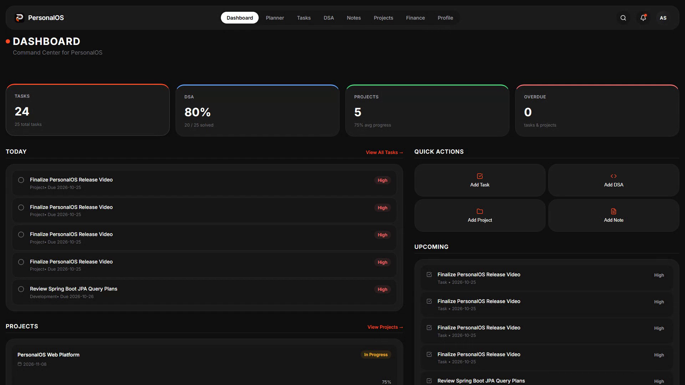
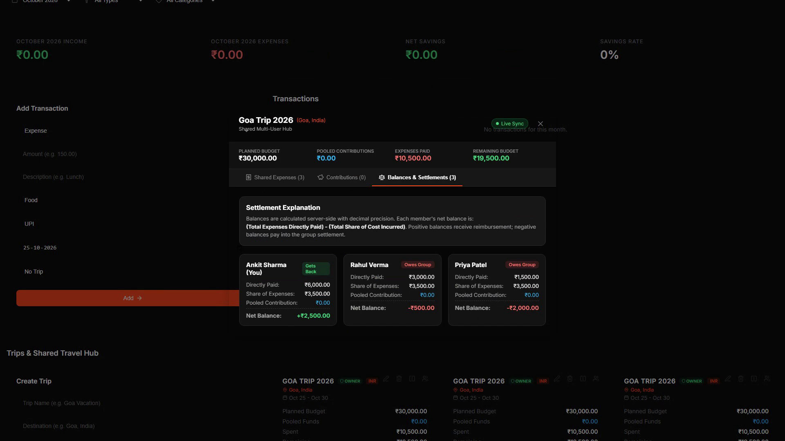
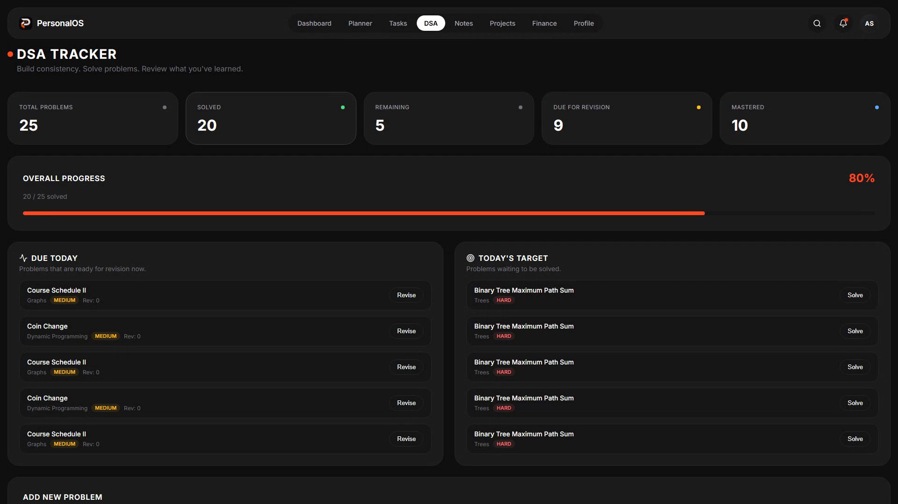
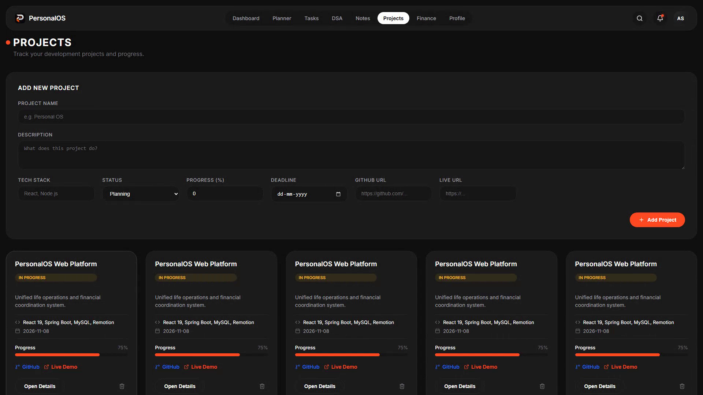
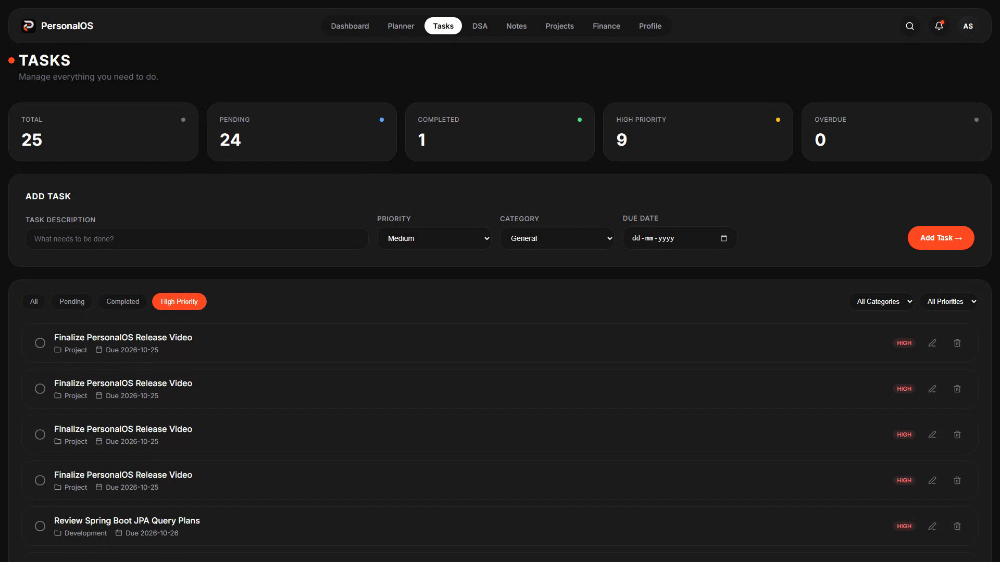
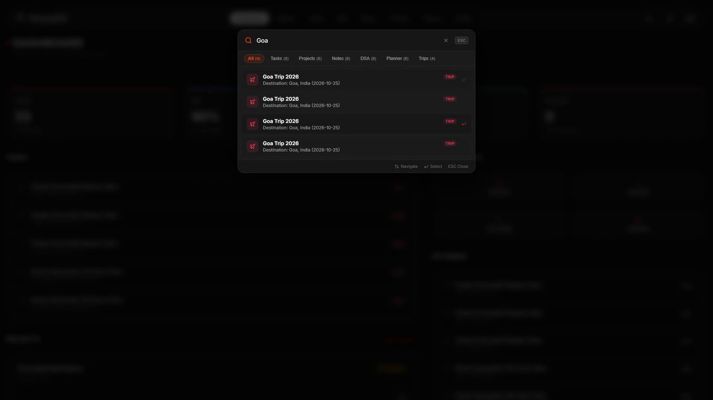
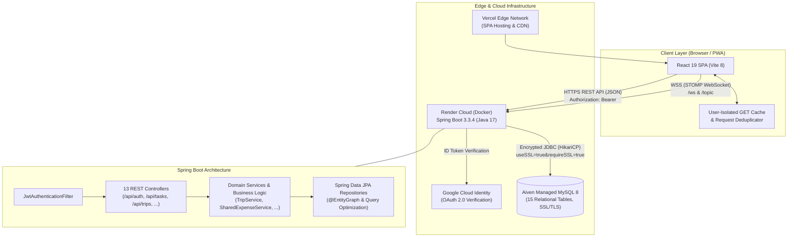

# PersonalOS

[](https://openjdk.org/)
[](https://spring.io/projects/spring-boot)
[](https://react.dev/)
[](https://vitejs.dev/)
[](https://www.mysql.com/)
[](.github/workflows/ci.yml)

PersonalOS is a personal productivity, engineering workflow, and shared financial coordination operating system. Designed to replace fragmented note apps, task checklists, and spreadsheet split-calculators, it unifies daily schedules, LeetCode preparation, engineering project tracking, personal budgeting, and collaborative group travel finances into a single fast, dark-mode web application.

---

## Live Deployments

| Component | Platform | URL | Operational Status |
|---|---|---|---|
| **Frontend Application** | Vercel Edge | [https://personal-os-five-sigma.vercel.app/](https://personal-os-five-sigma.vercel.app/) | Active (Global CDN) |
| **Backend REST & WebSocket API** | Render Cloud | [https://personal-os-backend-81o2.onrender.com/](https://personal-os-backend-81o2.onrender.com/) | Active (Docker Web Service) |
| **API Health Probe** | Render Cloud | [https://personal-os-backend-81o2.onrender.com/api/health](https://personal-os-backend-81o2.onrender.com/api/health) | `HTTP 200 {"status":"UP"}` |

> **Note on Free-Tier Hosting:** The backend service is hosted on Render's free tier. If the application has been idle for more than 15 minutes, Render spins down the backend container to conserve resources. The first incoming request will trigger an automatic cold-start spin-up taking approximately 45–60 seconds, after which all subsequent requests respond with normal sub-second latency.

---

## Visual Preview

### Command Center & Dashboard
A high-level operational overview summarizing pending tasks, DSA problem mastery, active software projects, and quick-action creation shortcuts.


### Group Travel Hub & Automated Expense Settlement Engine
Collaborative multi-user trip management. Invite friends with a 6-character code, track shared expenses with custom or equal splits, and view real-time mathematical net balances.


### DSA Interview Preparation Tracker
Topic-wise LeetCode tracker with difficulty tagging, progress indicators, and dedicated revision bookmarking before interview rounds.


### Engineering Projects Workspace
Project dashboard featuring repository and live demo links, technology stack tags, subtask checklists, and visual completion progress.


### Task Management
Fast task organization with immediate priority filtering (`High Priority`, `Pending`, `Completed`), category tagging, and optimistic checkbox toggling.


### Universal Search (`Ctrl+K`)
Keyboard-driven workspace search indexing tasks, projects, notes, planner items, and shared trip records simultaneously.


---

## Core Features

- **Operational Dashboard:** Real-time metrics tracking pending tasks, interview preparation rates, active projects, quick-action shortcuts, and today's focus items.
- **Task Management:** Instant category and priority filtering (`Low`, `Medium`, `High`), due dates, optimistic checkbox toggling, and client-side rollback on API failure.
- **DSA Interview Tracker:** Curate LeetCode and data structure problems categorized by topic (e.g., Graphs, Dynamic Programming, Trees) and difficulty (`Easy`, `Medium`, `Hard`) with dedicated revision flags for upcoming technical interviews.
- **Project Workspace:** Track development initiatives with tech stack tags, repository links, production URLs, visual completion percentages, and interactive subtask checklists.
- **Notes & Scratchpad:** Color-coded, categorized note capture with full markdown/plain-text editing and client-side title/content filtering.
- **Daily Planner & Time-Blocking:** Schedule daily tasks across hourly time blocks, track completion, and organize daily workflows by calendar date.
- **Personal Budgeting & Finance:** Monthly income, expense, and net savings logging with category attribution (Food, Transport, Utilities, Tech, etc.).
- **Shared Trips & Group Expense Settlement Engine:**
  - Create shared trips and generate 6-character join codes for collaborative access.
  - Record shared group expenses with flexible split modes (equal split or custom member shares).
  - Calculate exact server-side net balances (`Net Balance = Directly Paid - Share Incurred`) to clearly resolve who owes whom with zero mathematical ambiguity.
  - Track pooled group fund contributions alongside direct member payments.
- **Universal Keyboard Search (`Ctrl+K`):** Global modal search across tasks, projects, notes, planner items, and trips with instant keyboard navigation.
- **Dual Authentication & Session Security:**
  - Google OAuth 2.0 integration with cryptographic state verification cookies to prevent CSRF.
  - Native Email/Password authentication secured with BCrypt password hashing.
  - Stateless JWT access tokens (HMAC-SHA256) combined with secure `HttpOnly` refresh token rotation.
- **Performance Optimizations:**
  - User-isolated in-memory GET caching in `apiClient.js` with instant mutation invalidation.
  - Client-side request deduplication merging identical concurrent in-flight requests.
  - Route-level code splitting using `React.lazy` and `Suspense` for minimal initial bundle overhead.

---

## Technology Stack

### Frontend
- **Framework:** React 19.2
- **Routing:** React Router 7.1 (with route-level code splitting)
- **Build Tool:** Vite 8.3
- **Icons & Animation:** Lucide React, Framer Motion
- **Styling:** Custom Vanilla CSS Design System with dark theme and `#ff4a22` accent
- **Offline / PWA:** Vite PWA (`vite-plugin-pwa`) with client-side caching
- **Real-Time Messaging:** `@stomp/stompjs` for WebSocket subscriptions

### Backend
- **Language & Runtime:** Java 17 (Eclipse Temurin / OpenJDK)
- **Framework:** Spring Boot 3.3.4
- **Security:** Spring Security 6, JJWT (`io.jsonwebtoken 0.11.5`), BCrypt password hashing
- **OAuth Integration:** Google API Client (`com.google.api-client 2.2.0`)
- **Data Access:** Spring Data JPA with Hibernate ORM
- **Database Pooling:** HikariCP
- **Real-Time Communication:** Spring WebSocket with STOMP message broker

### Database & Persistence
- **Engine:** MySQL 8
- **Schema:** 15 normalized relational tables with cascading foreign keys, strict check constraints, and indexed lookups ([schema.sql](backend/src/main/resources/schema.sql))
- **Production Host:** Aiven Managed Cloud MySQL with mandatory SSL/TLS encryption

### DevOps & Infrastructure
- **Frontend Hosting:** Vercel Edge Network
- **Backend Hosting:** Render Cloud (Docker containerization)
- **Continuous Integration:** GitHub Actions ([.github/workflows/ci.yml](.github/workflows/ci.yml)) running ESLint, Vite production packaging, JUnit 5 test suites, and Maven JAR builds

---

## System Architecture



---

## Local Development Setup

### Prerequisites
Ensure the following tools are installed on your machine:
- **Node.js:** Version 20+ and `npm`
- **Java Development Kit (JDK):** Version 17+ (e.g., Eclipse Temurin or OpenJDK)
- **Build Tool:** Apache Maven 3.8+
- **Database Server:** MySQL 8 running locally on port `3306`

---

### Step 1: Clone the Repository
```bash
git clone https://github.com/ankitanmol26/Personal-OS.git
cd Personal-OS
```

---

### Step 2: Database Initialization
Open your MySQL terminal or GUI client (DBeaver, MySQL Workbench) and create the database:
```sql
CREATE DATABASE personal_os CHARACTER SET utf8mb4 COLLATE utf8mb4_unicode_ci;
```

---

### Step 3: Configure and Run Backend
1. Navigate to the `backend` directory:
   ```bash
   cd backend
   ```
2. Copy the template configuration file:
   ```bash
   cp application-local.properties.example application-local.properties
   ```
3. Edit `application-local.properties` with your local MySQL password and a strong JWT secret (at least 32 characters):
   ```properties
   spring.datasource.url=jdbc:mysql://localhost:3306/personal_os?useSSL=false&serverTimezone=UTC&allowPublicKeyRetrieval=true
   spring.datasource.username=personalos
   spring.datasource.password=your_mysql_password
   personalos.jwt.secret=your_super_secret_jwt_signing_key_minimum_32_bytes_long
   personalos.frontend.url=http://localhost:5173
   ```
4. Run tests and start the Spring Boot application:
   ```bash
   mvn test
   mvn spring-boot:run
   ```
   The backend service starts at `http://localhost:8080`.

---

### Step 4: Configure and Run Frontend
1. Open a new terminal and return to the repository root:
   ```bash
   cd Personal-OS
   ```
2. Create your frontend environment file:
   ```bash
   cp .env.example .env
   ```
3. Update `.env` for local execution:
   ```env
   VITE_API_BASE_URL=http://localhost:8080
   VITE_WS_URL=ws://localhost:8080/ws
   VITE_GOOGLE_CLIENT_ID=your-google-oauth-client-id.apps.googleusercontent.com
   ```
4. Install dependencies and start the Vite development server:
   ```bash
   npm install
   npm run dev
   ```
5. Open your browser and navigate to `http://localhost:5173`.

---

## Environment Configuration

The application strictly separates client-side public configuration from server-side secrets. Never commit production credentials, tokens, or `.env` files to source control.

### Frontend Variables (`.env`)

| Variable Name | Required | Description | Safe Example |
|---|---|---|---|
| `VITE_API_BASE_URL` | **Yes** | Root HTTPS URL of the backend API | `https://your-backend.onrender.com` or `http://localhost:8080` |
| `VITE_WS_URL` | No | WebSocket endpoint (auto-derived if omitted) | `wss://your-backend.onrender.com/ws` or `ws://localhost:8080/ws` |
| `VITE_GOOGLE_CLIENT_ID` | **Yes** | Google Cloud OAuth 2.0 Web Client ID | `123456789-abc.apps.googleusercontent.com` |

### Backend Variables (Render Dashboard / `application-local.properties`)

| Variable Name | Required | Description | Safe Example |
|---|---|---|---|
| `SPRING_PROFILES_ACTIVE` | **Yes (Prod)** | Spring environment profile (`prod` in cloud) | `prod` |
| `DB_URL` | **Yes** | JDBC connection string with SSL configuration | `jdbc:mysql://<host>:<port>/<dbname>?useSSL=true&serverTimezone=UTC` |
| `DB_USERNAME` | **Yes** | Database user | `avnadmin` or `personalos` |
| `DB_PASSWORD` | **Yes** | Database password | `<strong-database-password>` |
| `DB_POOL_SIZE` | No | HikariCP maximum connection pool size (default: `10`) | `10` |
| `PERSONALOS_JWT_SECRET` | **Yes** | Cryptographic HMAC-SHA256 signing secret (≥ 32 chars) | `<256-bit-random-secret>` |
| `PERSONALOS_FRONTEND_URL` | **Yes** | Allowed CORS origin without trailing slash | `https://your-frontend.vercel.app` |
| `GOOGLE_OAUTH_CLIENT_ID` | Optional | Google OAuth Web Client ID for token validation | `123456789-abc.apps.googleusercontent.com` |
| `GOOGLE_OAUTH_CLIENT_SECRET` | Optional | Google OAuth Client Secret | `<oauth-client-secret>` |
| `PORT` | Auto | Server port (injected automatically by Render) | `8080` |

---

## API Endpoint Overview

All endpoints under `/api` (with the exception of health and public authentication routes) require a valid `Authorization: Bearer <JWT>` header or a verified session.

| Group | Method | Path | Access | Description |
|---|---|---|---|---|
| **Health** | `GET` | `/api/health` | Public | System liveness probe returning `{"status":"UP"}` |
| **Auth** | `POST` | `/api/auth/register` | Public | Register new email/password account |
| | `POST` | `/api/auth/login` | Public | Authenticate user; returns JWT & sets refresh cookie |
| | `GET` | `/api/auth/google/state` | Public | Issue signed CSRF state cookie for OAuth2 flow |
| | `POST` | `/api/auth/google` | Public | Exchange Google ID token for authenticated session |
| | `POST` | `/api/auth/refresh` | Public | Rotate refresh token and issue fresh access token |
| | `POST` | `/api/auth/logout` | Authenticated | Revoke refresh token and clear auth cookies |
| | `GET` | `/api/auth/me` | Authenticated | Fetch active user credentials and metadata |
| **Tasks** | `GET`, `POST` | `/api/tasks` | Authenticated | List all user tasks or create a new task |
| | `GET`, `PUT`, `DELETE`| `/api/tasks/{id}` | Authenticated | Fetch, update, or remove a task |
| **DSA** | `GET`, `POST` | `/api/dsa` | Authenticated | List or record LeetCode problems |
| | `GET`, `PUT`, `DELETE`| `/api/dsa/{id}` | Authenticated | Fetch, update, or delete a problem |
| **Projects**| `GET`, `POST` | `/api/projects` | Authenticated | List or create development projects |
| | `GET`, `PUT`, `DELETE`| `/api/projects/{id}` | Authenticated | Manage individual project details |
| | `POST` | `/api/projects/{id}/tasks`| Authenticated | Append subtask checklist items to a project |
| | `PUT` | `/api/projects/{id}/tasks/{taskId}` | Authenticated | Update or toggle subtask completion |
| **Notes** | `GET`, `POST` | `/api/notes` | Authenticated | List or create markdown/text notes |
| | `GET`, `PUT`, `DELETE`| `/api/notes/{id}` | Authenticated | Read, edit, or delete a note |
| **Planner**| `GET`, `POST` | `/api/planner-tasks` | Authenticated | List or schedule daily time-block entries |
| | `GET`, `PUT`, `DELETE`| `/api/planner-tasks/{id}`| Authenticated| Update or remove time-blocked tasks |
| **Finance**| `GET`, `POST` | `/api/transactions` | Authenticated | Query or log personal transactions |
| | `GET`, `PUT`, `DELETE`| `/api/transactions/{id}`| Authenticated| Manage personal income/expense records |
| **Trips** | `GET`, `POST` | `/api/trips` | Authenticated | Retrieve or initiate a group travel workspace |
| | `GET`, `PUT`, `DELETE`| `/api/trips/{id}` | Authenticated | Retrieve, modify, or archive a group trip |
| | `GET`, `POST` | `/api/trips/join/{code}` | Authenticated | Query trip info or join a trip via invite code |
| | `POST` | `/api/trips/{id}/regenerate-invite` | Authenticated | Invalidate and generate a new join code |
| | `POST` | `/api/trips/{id}/leave` | Authenticated | Leave a collaborative trip workspace |
| | `GET`, `POST` | `/api/trips/{id}/members` | Authenticated | List or invite participants to a trip |
| | `DELETE` | `/api/trips/{id}/members/{userId}` | Authenticated | Remove a member from the trip |
| | `GET`, `POST` | `/api/trips/{id}/contributions` | Authenticated | Track pooled fund contributions |
| | `GET`, `POST` | `/api/trips/{id}/shared-expenses` | Authenticated | Log shared expenses with participant split rules |
| | `GET` | `/api/trips/{id}/shared-expenses/balances` | Authenticated | Calculate real-time net settlement balances |
| **Profile**| `GET`, `PUT` | `/api/profile/me` | Authenticated | Retrieve or update user bio, phone, and name |
| | `PUT` | `/api/profile/me/password` | Authenticated | Secure password modification endpoint |

---

## Project Structure

```text
Personal-OS/
├── .github/
│   └── workflows/
│       └── ci.yml               # Automated CI pipeline (Lint, Build, Maven Test)
├── backend/
│   ├── src/
│   │   ├── main/
│   │   │   ├── java/com/personalos/backend/
│   │   │   │   ├── configuration/   # SecurityConfig, WebSocketConfig, AllowedOriginsProvider
│   │   │   │   ├── controller/      # 13 REST API controllers
│   │   │   │   ├── dto/             # Data Transfer Objects with validation annotations
│   │   │   │   ├── entity/          # 11 JPA relational entity models
│   │   │   │   ├── exception/       # Global exception handling & error responses
│   │   │   │   ├── repository/      # Spring Data JPA repositories with query optimization
│   │   │   │   ├── security/        # JwtService, JwtAuthFilter, UserDetails
│   │   │   │   └── service/         # Core business logic & settlement calculations
│   │   │   └── resources/
│   │   │       ├── application.properties         # Development profile defaults
│   │   │       ├── application-prod.properties    # Production cloud profile (DDL none)
│   │   │       └── schema.sql                     # Authoritative 15-table relational schema
│   │   └── test/java/com/personalos/backend/      # 8 JUnit 5 & Mockito test suites
│   ├── Dockerfile               # Multi-stage production container build
│   ├── pom.xml                  # Maven dependencies & build configuration
│   └── README.md                # Backend architecture & developer documentation
├── docs/
│   └── screenshots/             # 1080p verified application screenshots
├── public/                      # Static branding, favicons, and PWA emblems
├── src/
│   ├── components/              # Shared UI components (Sidebar, SearchModal, Modals, StatCards)
│   ├── context/                 # React Context providers (AuthContext, NotificationContext)
│   ├── pages/                   # Lazy-loaded page views (Dashboard, Tasks, DSA, Projects, Finance, ...)
│   ├── services/                # API client with GET caching, deduplication, and service modules
│   ├── App.jsx                  # Route definitions, Suspense fallbacks, and layouts
│   └── main.jsx                 # Application entry point with PWA registration
├── .env.example                 # Safe environment variable template for frontend
├── DEPLOYMENT.md                # Comprehensive cloud deployment & operations guide
├── package.json                 # Frontend dependencies and npm scripts
├── render.yaml                  # Render Infrastructure-as-Code specification
├── vercel.json                  # SPA routing rewrite rules for Vercel
└── vite.config.js               # Vite bundler, PWA configuration, and build optimizations
```

---

## Security & Engineering Best Practices

- **Zero Committed Secrets:** All sensitive credentials (database passwords, JWT secret keys, OAuth client secrets) are loaded strictly via environment variables or git-ignored local property files (`application-local.properties`).
- **Cryptographic Token Handling:** JWT tokens use HMAC-SHA256 with minimum 256-bit entropy keys. Refresh tokens are stored in `HttpOnly`, `SameSite` cookies to prevent XSS-based token theft.
- **Strict CORS Origin Enforcement:** Cross-origin communication is handled by `AllowedOriginsProvider.java`, validating origin hosts against strict RFC 6454 rules and rejecting wildcard access in production.
- **Relational Integrity:** Foreign key relationships include cascading rules to prevent orphaned records. Financial settlement calculations use server-side arithmetic to prevent rounding inconsistencies across distributed clients.
- **Fail-Safe UI Optimistic Updates:** Client-side mutations update the UI immediately for responsiveness, but automatically roll back to the previously cached snapshot if the backend API returns an error status.

---

## Verification & Automated Testing

The codebase includes automated continuous integration via GitHub Actions ([.github/workflows/ci.yml](.github/workflows/ci.yml)):

- **Frontend CI:**
  ```bash
  npm run lint    # ESLint static analysis and syntax validation
  npm run build   # Production Vite bundle and PWA service worker build
  ```
- **Backend CI:**
  ```bash
  mvn test                   # Runs JUnit 5 test suites (Auth, JWT, Trips, Shared Expenses)
  mvn package -DskipTests    # Verifies production JAR artifact packaging
  ```

---

## Project Roadmap

- [ ] **Automated Email Notifications:** Scheduled reminders for pending tasks and approaching project deadlines.
- [ ] **Trip Financial Statement Export:** Generate downloadable PDF/CSV expense reports for group trip settlements.
- [ ] **Web Push Notifications:** Real-time push updates for shared trip contributions using the PWA service worker.
- [ ] **Recurring Transactions:** Support for scheduled repeating income and recurring monthly subscription expenses.

---

## Contributing

Contributions, bug reports, and suggestions are welcome. To contribute:

1. Fork the repository on GitHub.
2. Create a descriptive feature branch:
   ```bash
   git checkout -b feature/your-feature-name
   ```
3. Commit your changes following clean commit standards:
   ```bash
   git commit -m "feat: add your feature description"
   ```
4. Push to your branch:
   ```bash
   git push origin feature/your-feature-name
   ```
5. Open a Pull Request detailing the changes made and any relevant testing steps.

---

## License

This repository does not currently include an open-source license file. A formal licensing decision (such as the MIT License or Apache 2.0) is pending review by the repository owner. All rights are reserved by the author until a license is formally committed.

---

## Author & Contact

- **Author / Repository Owner:** [Ankit Sharma](https://github.com/ankitanmol26) (`ankitanmol26`)
- **Repository:** [https://github.com/ankitanmol26/Personal-OS](https://github.com/ankitanmol26/Personal-OS)
- **Live Application:** [https://personal-os-five-sigma.vercel.app/](https://personal-os-five-sigma.vercel.app/)
